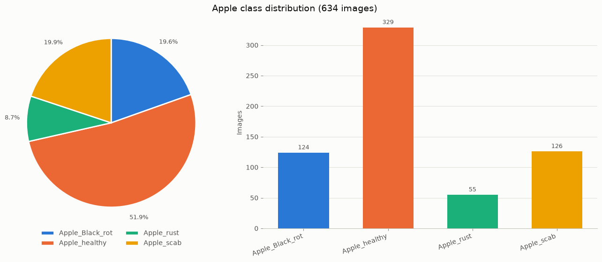
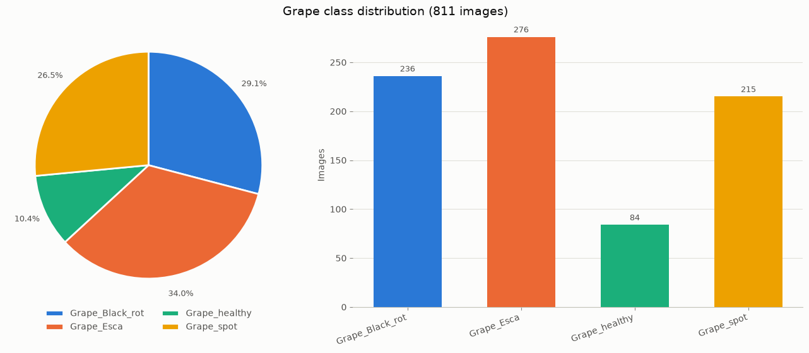
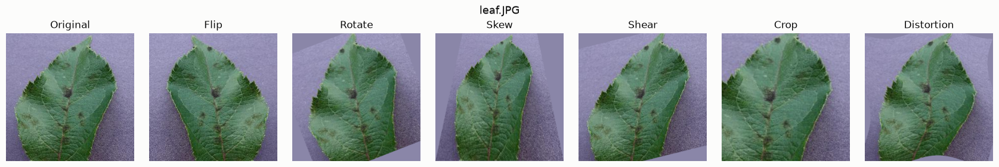
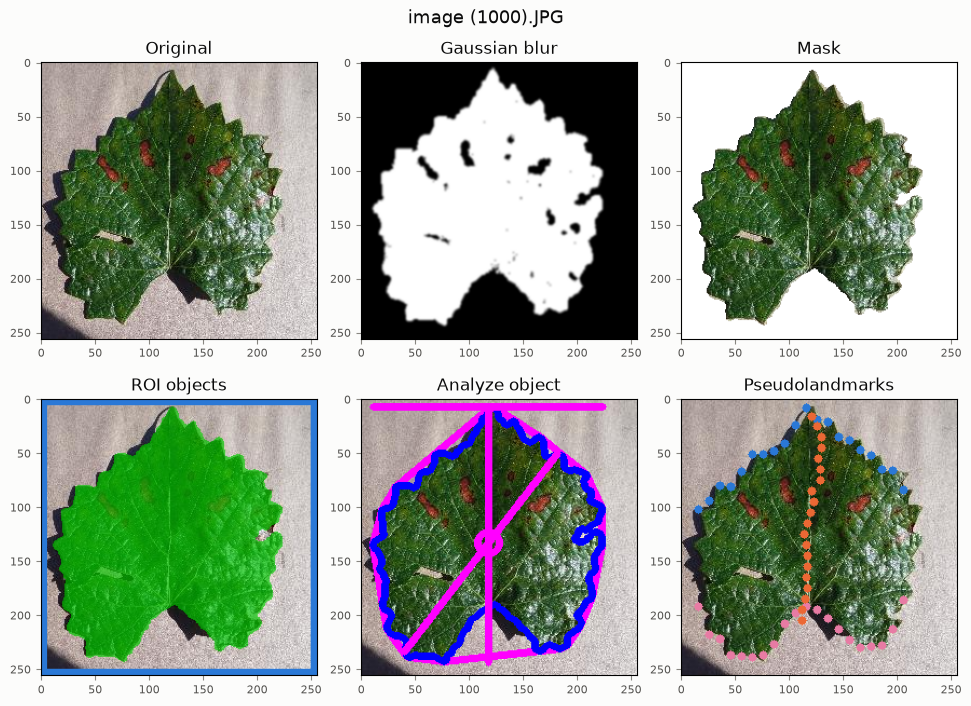
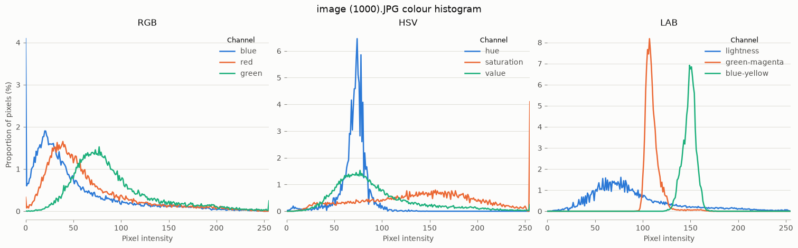
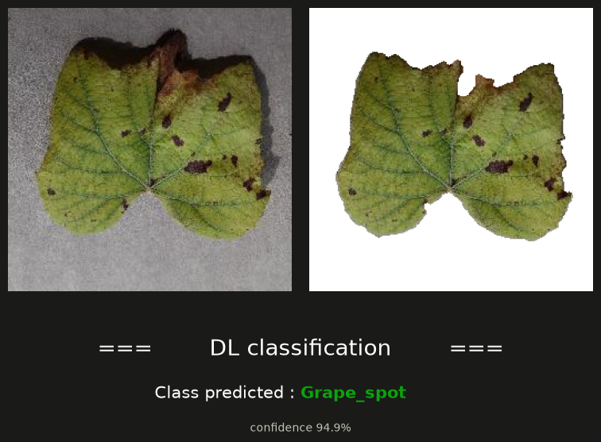

# Leaffliction

## 📖 About

"Leaffliction" is a **computer vision** project written in **Python**: a
complete image-classification pipeline that recognises plant diseases from
photographs of leaves. Given 7 221 photos of apple and grape leaves sorted into
eight classes — healthy, black rot, rust, scab, esca, spot — the program learns
to tell them apart and names the disease of a leaf it has never seen.

The pipeline is split into four programs, one per stage. **Distribution**
counts the images of every class and charts them, which shows how imbalanced
the dataset is. **Augmentation** creates plausible new photos from existing
ones — flips, rotations, skews, shears, crops, distortions — and balances the
classes with them. **Transformation** isolates the leaf with **PlantCV** and
extracts what a botanist would look at: its mask, its outline and shape, its
landmarks and its colour histograms. **train** and **predict** fit a
**convolutional neural network** written with **PyTorch** on background-free
leaves and classify new images.

The interesting part is everything around the network. The leaf is segmented
on a colour channel built for the job (`b − a` in LAB) so that the model never
learns the photo setup instead of the disease; the dataset is split **per leaf**
before any augmentation, so no copy of a validation leaf is ever trained on;
the validation set is never used to tune anything; and the trained model, the
images it learned from and its metadata are packed into `learnings.zip`, whose
**SHA-1** in `signature.txt` proves later that the model being evaluated is the
one that was trained.

The model packaged here scores **100 % on the 1 445 validation images**.

## 🎯 Objectives

- Reading an image dataset whose classes are its folders, flat or nested by
  plant, and measuring how imbalanced it is
- Implementing six geometric augmentations and balancing every class with them
  without ever augmenting an augmented image
- Segmenting a leaf from its background reliably enough to train on the leaf
  alone
- Extracting features with PlantCV: masks, regions of interest, shape analysis,
  pseudolandmarks and colour histograms in RGB, HSV and LAB
- Splitting the data per leaf and per class so that the validation score is an
  honest estimate, free of data leakage
- Designing, training and evaluating a convolutional network with PyTorch
- Reaching at least 90 % accuracy on a validation set of at least 100 images
- Packaging the learnings in a zip and signing it so the result can be checked
- Reporting every bad input with a message and an exit code, never a traceback

## 📋 Function Overview

<details>
<summary><strong>Leaffliction — modules breakdown</strong></summary>

<br>

| Module | Feature | Description |
|--------|---------|-------------|
| **Distribution** | Class counts | Prints a count table and draws, per plant type, a pie chart and a bar chart with the same colour per class |
| **Augmentation** | One image | Saves `<name>_Flip.JPG`, `_Rotate`, `_Skew`, `_Shear`, `_Crop`, `_Distortion` next to the original and displays them |
| **Augmentation** | A dataset | Copies it into `augmented_directory/` and adds augmented images until every class reaches the target |
| **Transformation** | Views | Gaussian blur, mask, ROI objects, analyze object, pseudolandmarks, colour histogram; displayed for one image, saved for a directory |
| **train** | Pipeline | Split per leaf, balance the training part, remove backgrounds, train `LeafCNN`, zip the learnings, write the signature |
| **predict** | Classification | One image: the class, its confidence and a figure; a directory: accuracy, per-class accuracy, confusion matrix, misclassified files |
| **dataset** | Discovery | Classes are the folders that hold images; plant type from the parent folder or the name prefix; hidden files ignored |
| **dataset** | Leaf groups | An image, its augmented copies and its byte-identical duplicates form one group that lands on one side of the split |
| **augment** | Six techniques | Each one `(image, rng) -> image`, seeded from the seed, the file and the technique; uncovered areas take the background colour |
| **balance** | Plan | Which source gets which technique, in rounds, so techniques stay evenly spread and no name is overwritten |
| **mask** | Segmentation | Otsu threshold on `b − a`, hysteresis, blur, opening and closing, largest component, hole filling |
| **transform** | PlantCV views | The six views built on one segmentation |
| **histogram** | Colour | Share of leaf pixels at each intensity, for the nine channels of RGB, HSV and LAB |
| **data** | Network input | Segment → remove background → 128×128 → `[-1, 1]`, the same function for training and prediction |
| **model** | `LeafCNN` | Four convolution blocks, global average pooling, dropout, one linear layer; 1.2 M parameters |
| **training** | Fit and report | AdamW, one-cycle schedule, label smoothing, random flips and quarter turns, mixed precision on GPU |
| **learnings** | Bundle | Work directory, zip, SHA-1 signature, loading the model straight from the zip |
| **parallel** | Process pool | Order-preserving `ProcessPoolExecutor` with a progress counter, clean on `Ctrl+C` |
| **cli** | Plumbing | One exit path: `0` success, `1` error, `2` bad arguments, `130` interrupted; figures saved as PNG without a display |

<br>

</details>

<details>
<summary><strong>Usage Example & Testing</strong></summary>

### Install and run

```bash
make install        # .venv with Python 3.13 and the CPU build of PyTorch (TORCH=cuda for the CUDA one)
make predict        # downloads learnings.zip, checks signature.txt, scores the validation images
make distribution   # with the dataset in images/: also augmentation, transformation, train
make test           # pytest; make lint for flake8
make fclean         # the .venv and everything generated (learnings.zip is kept)
```

### Distribution

```bash
$ ./src/Distribution.py learnings/validation
Apple: 4 classes, 634 images
  Apple_Black_rot     124   19.6%
  Apple_healthy       329   51.9%
  Apple_rust           55    8.7%
  Apple_scab          126   19.9%
Grape: 4 classes, 811 images
  Grape_Black_rot     236   29.1%
  Grape_Esca          276   34.0%
  Grape_healthy        84   10.4%
  Grape_spot          215   26.5%
```

<div align="center">

<table>
  <tr>
    <td width="50%" align="center"></td>
    <td width="50%" align="center"></td>
  </tr>
</table>

</div>

<p align="center"><sub>Drawn from the validation images packaged in <code>learnings.zip</code>. The split is stratified per class, so the shares are those of the whole dataset: <code>Apple_healthy</code> alone is half of the apple leaves, <code>Apple_rust</code> under a tenth.</sub></p>

### Augmentation

```bash
$ ./src/Augmentation.py leaf.JPG
Saved ./leaf_Flip.JPG
…
Saved ./leaf_Distortion.JPG
```

<p align="center">
  
</p>

### Transformation

```bash
./src/Transformation.py "images/Grape_Esca/image (1000).JPG"                    # displays the views
./src/Transformation.py -src images/Apple_rust -dst transformed -mask -pseudo
```

<p align="center">
  
</p>

<p align="center"><sub><code>./src/Transformation.py</code> on a <code>Grape_Esca</code> leaf: the original, the smoothed mask, the leaf on white, the region of interest, the shape analysis and the pseudolandmarks.</sub></p>

<p align="center">
  
</p>

<p align="center"><sub>The colour histogram of the same leaf: brown lesions raise the red channel and push <code>a</code> from green toward magenta.</sub></p>

### Prediction

```bash
$ ./src/predict.py "learnings/validation/Grape_spot/image (1000).JPG"
Class predicted: Grape_spot (94.9%)

$ ./src/predict.py learnings/validation
Accuracy: 100.00% (1445/1445 images)

Per class:
   0  Apple_Black_rot  100.00%  (124/124)
   1  Apple_healthy    100.00%  (329/329)
   …
   7  Grape_spot       100.00%  (215/215)
```

<p align="center">
  
</p>

### Error handling

```bash
$ ./src/Distribution.py nope/
Error: nope/: no such file or directory
$ ./src/Distribution.py empty/
Error: empty/: no images found
$ ./src/Augmentation.py README.md
Error: README.md: not a readable image
$ ./src/Transformation.py -src images/Apple_rust
Transformation.py: error: -src requires -dst
$ ./src/train.py --epochs 0 images/
train.py: error: --epochs and --batch-size must be positive
```

Errors print one line on standard error and exit with `1`, invalid arguments
exit with `2`, and `Ctrl+C` exits with `130`; no program ever prints a
traceback.

### Tests

```bash
python -m pytest -q   # 107 tests, one to three minutes; no dataset needed
flake8 src tests      # PEP 8
```

The suite builds synthetic leaves, so it does not depend on the dataset; the
one check on real images is skipped when `images/` is absent.

| File | Covers |
|---|---|
| `test_dataset.py` | Extensions and hidden files, flat and nested layouts, augmented names, per-leaf split without leakage, duplicate photos, invalid roots |
| `test_augment.py` | Every technique on square, rectangular and tiny images; reproducibility; the balancing plan |
| `test_imageio.py` | Grayscale and RGBA input, spaces and non-ASCII paths, empty, corrupt and truncated files |
| `test_mask_transform.py` | Mask accuracy on synthetic leaves (IoU), uniform images, view sizes, histogram percentages, saved names |
| `test_learnings.py` | Model output shape, zip layout and round trip, SHA-1 and `sha1sum -c`, corrupt archives, work-directory safety |
| `test_cli.py` | The five programs end to end, headless, with a full train → predict run on CPU; any traceback fails |

<br>

</details>

## 🚀 Installation & Structure

<details>
<summary><strong>📥 Setup & Usage</strong></summary>

<br>

### Host requirements

| Item | Needed for | Notes |
|------|------------|-------|
| Python 3.13, or `uv` | Everything | 3.14 is not supported: PlantCV pins `scipy<1.16`, which has no 3.14 wheels; `uv` installs 3.13 without root |
| `make`, `curl`, `unzip` | Install and run | `make install` creates `.venv/` with `requirements.txt` |
| PyTorch, PlantCV, OpenCV, NumPy, Matplotlib | The programs | Pinned in `requirements.txt`, installed by `make install` |
| `images/` | Distribution, Augmentation, train | The leaf dataset, extracted at the repository root; not in git |
| `learnings.zip` | predict | The signed bundle, downloaded from the project's release by `make learnings`; not in git |
| A CUDA GPU | Optional | Everything runs on the CPU; only full training is slow there |

### Install

```bash
make install              # .venv, CPU build of PyTorch (about 1.5 GB)
make install TORCH=cuda   # or the CUDA build (about 6 GB)
make learnings            # downloads learnings.zip and checks it against signature.txt
```

By hand, the same steps are:

```bash
python3.13 -m venv .venv                                     # with an installed Python 3.13
uv venv --python 3.13 --seed .venv                           # or with uv (downloads 3.13 if needed)
source .venv/bin/activate

pip install -r requirements.txt                              # NVIDIA GPU: CUDA build, about 6 GB
pip install -r requirements.txt \
    --extra-index-url https://download.pytorch.org/whl/cpu   # CPU build, about 1.5 GB
```

The installation is checked with:

```bash
python -c "import torch, plantcv, cv2; print(torch.__version__, 'CUDA:', torch.cuda.is_available())"
```

### Verify the learnings

```bash
sha1sum -c signature.txt   # Linux:  learnings.zip: OK
shasum -c signature.txt    # macOS
```

`FAILED` means `learnings.zip` is not the archive that was signed: another
training run, or a re-compressed copy. `predict.py` reads the model straight
from the zip, so the prediction always comes from the signed file; extracting
it (`unzip -q learnings.zip`) is only needed to browse its images.

### Running

Every program prints its options with `-h`, and saves its figures as PNG in
the current directory when there is no display (SSH, CI, `MPLBACKEND=Agg`).

| Program | Main options |
|---|---|
| `Distribution.py <dir>` | A dataset or a single class |
| `Augmentation.py <path>` | `--dst DIR`, `--target N` images per class, `--seed N` (7) |
| `Transformation.py <image>` | Or `-src PATH -dst DIR`, with `-blur -mask -roi -analyze -pseudo -hist` to pick views |
| `train.py <dir>` | `--epochs` (20), `--batch-size` (64), `--img-size` (128), `--lr` (0.002), `--val-split` (0.2), `--seed` (7), `--device` |
| `predict.py <path>` | An image or a directory; `--learnings` (`learnings.zip`), `--device` |

### Dataset layout

```
images/                      Apple/
├── Apple_Black_rot/         ├── apple_healthy/
├── Apple_healthy/           ├── apple_scab/
├── ...                      └── ...
└── Grape_spot/
```

Every directory that directly holds images is a class, named after the
directory. The plant type is the parent folder when nested, otherwise the part
of the name before the first underscore. Extensions `.jpg .jpeg .png .bmp .tif
.tiff` are read in any letter case; hidden files and folders are ignored.

### Troubleshooting

| Symptom | Cause and fix |
|---|---|
| `No matching distribution found for scipy` / `plantcv` | Wrong Python version: use 3.13 |
| `No space left on device` during `pip install` | Use the CPU build, or create the environment on a larger disk and link it |
| Figures saved as PNG on a desktop | This Python has no `tkinter`: install `python3-tk` or use uv's Python |
| `ModuleNotFoundError` | The virtual environment is not active |
| `learnings: exists and was not created by train.py` | `train.py` refuses to wipe a folder it did not create: use `--workdir`, `--out` and `--signature` |

<br>

</details>

<details>
<summary><strong>📁 Project Structure</strong></summary>

<br>

```
Leaffliction/
│
├── README.md               # Main project documentation
├── requirements.txt        # Pinned dependencies
├── signature.txt           # SHA-1 of learnings.zip
├── Makefile                # install (.venv), learnings, predict, the programs, test, lint
├── .gitignore              # Dataset, learnings, generated folders, headless figures (docs/img is kept)
│
├── docs/
│   ├── README.md           # Condensed project documentation
│   └── img/                # Figures drawn by the programs, used in this README
│
├── src/
│   ├── Distribution.py     # Class counts and charts
│   ├── Augmentation.py     # One image augmented, or a dataset balanced
│   ├── Transformation.py   # PlantCV views, displayed or saved
│   ├── train.py            # Split, balance, train, package, sign
│   ├── predict.py          # Classify one image or score a folder
│   │
│   └── leaffliction/
│       ├── cli.py          # Error handling, exit codes, figure display
│       ├── imageio.py      # Reading and writing images (BGR, any path)
│       ├── dataset.py      # Classes, plant types, leaf groups, split
│       ├── augment.py      # The six augmentations
│       ├── balance.py      # Balancing plan and file jobs
│       ├── parallel.py     # Process pool with progress
│       ├── mask.py         # Leaf segmentation
│       ├── transform.py    # The PlantCV views
│       ├── histogram.py    # Colour histograms
│       ├── figures.py      # Every matplotlib figure
│       ├── data.py         # Network input preparation
│       ├── model.py        # LeafCNN
│       ├── training.py     # Training loop, inference, report
│       └── learnings.py    # Work directory, zip, signature, loading
│
└── tests/                  # pytest suite on synthetic leaves
```

The five programs are thin: they parse their arguments and call the
`leaffliction` package, so training and prediction share the very same
segmentation and preprocessing.

```
learnings.zip
└── learnings/
    ├── model.pt              # network weights (PyTorch state dict)
    ├── meta.json             # class names, input size, seed, split sizes, validation accuracy
    ├── metrics.txt           # validation report
    ├── train/<class>/        # balanced training set: augmented, background removed
    └── validation/<class>/   # untouched validation images
```

<br>

</details>

<details>
<summary><strong>🧱 Pipeline Overview</strong></summary>

<br>

### Pipeline

```
images/ ─> leaf groups ─> split per leaf (80 / 20, stratified)
              train ─> balance with augmentations ─> segment ─> remove background ─> 128×128 ─> LeafCNN
              validation (originals only) ─────────> segment ─> remove background ─> 128×128 ─> score
          model.pt + meta.json + metrics.txt + images ─> learnings.zip ─> sha1 ─> signature.txt
```

### Augmentation

| Technique | What it does | Why it is plausible for a leaf |
|---|---|---|
| Flip | Mirror horizontally, vertically or both | Leaves have no fixed orientation |
| Rotate | 15–45° either way | A photo can be taken at any angle |
| Skew | Projective tilt: one edge shrinks toward its centre | Camera not parallel to the leaf |
| Shear | Slant along x or y | Same, with an affine model |
| Crop | Keep 70–85 % of the image, scale back up | Zoom, partial framing |
| Distortion | Smooth sinusoidal warp of the pixel grid | Leaves are not flat |

Areas uncovered by a transform take the image's median border colour, the
background, rather than black or a mirror copy, so the segmentation never
mistakes them for leaf. Balancing only uses originals as sources and gives each
source every technique at most once, so a class can grow to at most 7× its
originals; a warning says so when the target is out of reach.

### Segmentation

```
channel  = b − a  (LAB)              leaves green to brown: high b, low a; grey or purple backgrounds: the opposite
sure     = channel > Otsu
leaf     = sure ∪ (pixels above the background level connected to sure)          hysteresis: lesions and glare
leaf     = blur → threshold → opening → closing → largest component → fill holes
```

A channel with almost no contrast (a blank image) is reported as "no leaf".
Removing the background matters: it stops the network from learning shortcuts
from the photo setup — background colour, shadows — instead of the disease.

### Split before augmenting

A file and its augmented copies (`x.JPG`, `x_Flip.JPG`, …), and byte-identical
photos (the dataset has 7 such pairs), share one group, and a whole group lands
on one side of the split. Validation keeps original images only. Augmenting
first and splitting afterwards would put copies of the same leaf on both sides:
that is data leakage, and it inflates the score.

### LeafCNN

| Stage | Layers | Output (128 px input) |
|---|---|---|
| Block 1 | 2 × (Conv 3×3 → BatchNorm → ReLU) → MaxPool 2 | 32 × 64 × 64 |
| Block 2 | same | 64 × 32 × 32 |
| Block 3 | same | 128 × 16 × 16 |
| Block 4 | same | 256 × 8 × 8 |
| Head | Global average pool → Dropout 0.3 → Linear | One score per class |

Trained with cross-entropy and label smoothing 0.05, AdamW, a one-cycle
learning rate peaking at 0.002, random flips and quarter turns on each batch,
and mixed precision on GPU. The number of epochs is fixed in advance and the
validation set never chooses a checkpoint, so its score is an honest estimate.

### Results

`./src/train.py images/` with the default settings (seed 7, 20 epochs, 128 px),
on an RTX 4050 laptop GPU, in 3 min 14 s:

| Split | Images | Accuracy |
|---|---|---|
| Training (balanced, augmented) | 10 488 | 99.98 % |
| **Validation (originals, leaves never seen in training)** | **1 445** | **100.00 %** |

The confusion matrix is diagonal, and a second run with another seed also
scored 100 %. The photos are taken in controlled conditions, one leaf on a
plain background; on field photos — cluttered backgrounds, several leaves,
other lighting — accuracy would be lower, since the segmentation assumes one
leaf on a uniform background.

<br>

</details>

## 💡 Key Learning Outcomes

- **Looking at the data first**: class imbalance, duplicates and the way the
  photos were taken matter as much as the model
- **Data augmentation**: geometric transforms that keep a leaf plausible, used
  both to balance classes and to regularise the network
- **Classical computer vision**: colour spaces, Otsu thresholding, hysteresis,
  morphology and connected components to segment an object
- **Feature extraction with PlantCV**: masks, shape analysis, landmarks and
  colour histograms, and what each says about a disease
- **Convolutional networks**: convolutions, batch normalisation, pooling,
  dropout and softmax, and how they combine into a classifier
- **Honest evaluation**: splitting by leaf, never tuning on validation, and why
  data leakage makes a score meaningless
- **Reproducibility**: seeds everywhere, one preprocessing function for training
  and prediction, and a signed bundle to prove which model was evaluated

## ⚙️ Technical Specifications

- **Language**: Python 3.13
- **Dependencies**: PyTorch 2.14, PlantCV 4.11, OpenCV 4.11, NumPy 2.4,
  Matplotlib 3.11; pytest and flake8 for the checks
- **Dataset**: 7 221 RGB images of 256×256 in 8 classes, from 275 `Apple_rust`
  to 1 640 `Apple_healthy`
- **Split**: per leaf group, stratified per class, 80 % training and 20 %
  validation; only the training part is balanced
- **Network input**: leaf on white, 128×128, scaled to `[-1, 1]`
- **Model**: `LeafCNN`, 4 convolution blocks, 1.2 M parameters
- **Training**: 20 epochs, batches of 64, AdamW, one-cycle to 0.002, label
  smoothing 0.05; about 3 minutes on a laptop GPU
- **Measured**: 100.00 % on 1 445 validation images, 99.98 % on the 10 488
  balanced training images
- **Bundle**: `learnings.zip` with the model, the metadata, the report and the
  images, published as a release asset and not in git; SHA-1 in
  `signature.txt`, `sha1sum` format
- **Exit codes**: `0` success, `1` error, `2` invalid arguments, `130` interrupted
- **Tests**: 107 pytest tests on synthetic leaves, flake8 clean

## 🔧 Requirements

- Python 3.13, with a virtual environment
- The packages of `requirements.txt` (CUDA or CPU build of PyTorch)
- The leaf dataset in `images/` to train or to run Distribution and
  Augmentation on it
- `learnings.zip` byte for byte, checked against `signature.txt`, to predict
- `curl` and `unzip`, or a browser, to get `learnings.zip` from the project's release

---

> [!NOTE]
> Leaffliction gets a perfect score not because the network is large but
> because the data is handled carefully: the leaf is cut out before the model
> sees it, no copy of a validation leaf is ever trained on, and the result is
> signed so that anyone can check it is the model that was actually trained.
